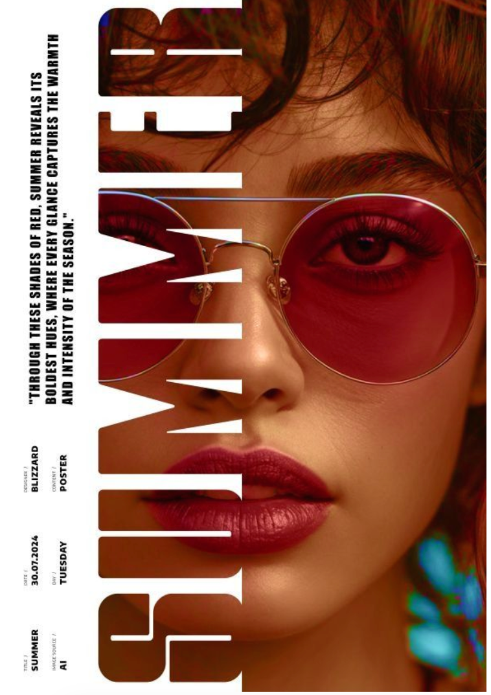
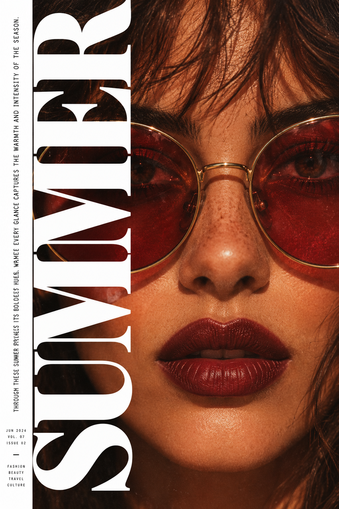

# CatchArt Image Prompt

[English](#what-it-does-well) · [简体中文](#中文介绍)

**Turn a reference image into a prompt you can use to create something new.**

CatchArt Image Prompt is a standalone image-to-prompt skill. It looks at the image, identifies its subject, composition, color, texture, and the relationships between elements, then writes coherent prompts in Chinese and English. Use it for visual exploration, style studies, and creating images in a similar direction.

## What it does well

- **Keeps the visual anchors.** Describes placement, overlap, negative space, and the hierarchy between type and image, rather than relying on a list of generic style words.
- **Respects the frame.** Matches the original to a nearby common aspect ratio, or follows a ratio you specify. It writes the ratio without forcing pixel dimensions.
- **Produces usable text.** Returns corresponding Chinese and English prompts by default. You can request either language on its own.
- **Checks the basics.** A local script validates length, aspect ratio, and output format. The skill uses the host agent's vision; it needs no CatchArt account or separate image-model API key.

## Case study: a summer editorial cover

| Reference image | Image generated from a reverse prompt |
| --- | --- |
|  |  |

The reference is close to a **2:3 portrait frame**. The prompt focused on the tightly cropped face, round red lenses, warm skin and dark hair, and oversized vertical lettering layered over the portrait. The generated image carries those main visual relationships forward. Facial details and small text differ from the reference. Both case images were provided by the user; this example shows a visual direction, not a pixel-for-pixel reproduction or a guaranteed result.

## Try it

Install the skill into your Codex skills directory:

```bash
git clone https://github.com/damonjobs2-dev/catchart-image-prompt.git ~/.codex/skills/catchart-image-prompt
```

Attach an image in a vision-enabled Codex chat, and ask:

> Use $catchart-image-prompt to turn this image into Chinese and English image-generation prompts.

You can add a direction such as “Chinese only,” “use a 4:5 frame,” or “keep the subject but switch to a cool palette.” See [SKILL.md](SKILL.md) for the full workflow.

The skill describes visible features. It cannot recover the creator's original hidden prompt, model settings, or font files. Results vary with the host agent and the image-generation model.

---

## 中文介绍

**把一张参考图，写成一段可以用于重新创作的提示词。**

CatchArt Image Prompt 是一个独立的图片反推 Skill。它会实际查看图片，抓住主体、构图、色彩、材质和元素之间的关系，再输出可复制的中文与英文提示词。它适合做视觉探索、风格研究和相近画面的再创作。

### 它关注什么

- **保留画面的识别点。** 优先描述主体位置、遮挡、留白、字体与图像的层级，而不是堆叠笼统的风格词。
- **照顾画幅。** 根据原图宽高匹配接近的常见比例；也可以指定目标比例。默认写比例，不写像素尺寸。
- **给出可直接使用的文字。** 默认生成内容对应的中英双语提示词；也可以只要其中一种语言。
- **做基础检查。** 本地脚本检查长度、比例和输出格式。Skill 使用当前 Agent 的视觉能力，无需 CatchArt 账号或另配模型 API 密钥。

### 案例：一张夏日杂志封面

| 参考图 | 根据反推提示词生成的图 |
| --- | --- |
|  |  |

这个案例中，参考图接近 **2:3 竖版**。反推时重点抓取了贴近画面的女性肖像、红色圆框墨镜、暖色皮肤与深棕头发，以及左侧纵向大字压在人像上的杂志排版。生成图延续了这些主要视觉关系；人脸细节、小字内容与原图仍有差异。两张案例图由用户提供，用于展示视觉方向，不能视为逐像素复刻或固定出图保证。

### 使用

安装到 Codex 技能目录：

```bash
git clone https://github.com/damonjobs2-dev/catchart-image-prompt.git ~/.codex/skills/catchart-image-prompt
```

在支持图片的 Codex 会话中附上参考图，然后输入：

> 使用 $catchart-image-prompt 反推这张图，输出中英文提示词。

也可以指定要求，例如“只要中文”“改成 4:5 画幅”或“保留人物，换成冷色调”。详细工作流程见 [SKILL.md](SKILL.md)。

提示词描述的是图片中可观察的视觉特征，无法找回原作者实际使用的隐藏提示词、模型参数或字体文件。不同 Agent 和生图模型会产生不同结果。
